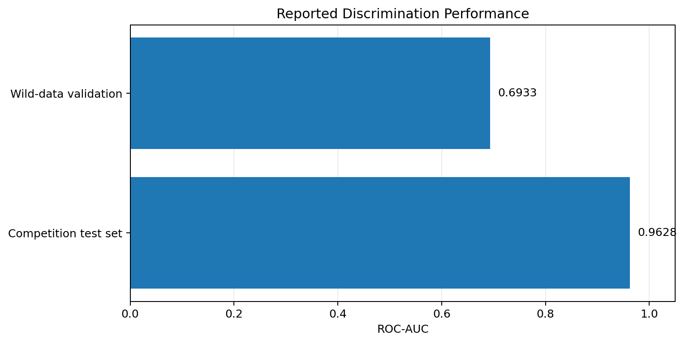
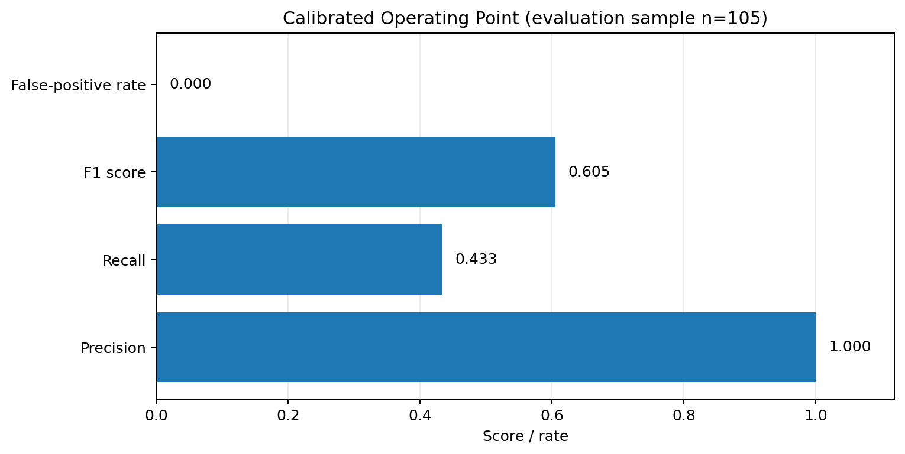

<div align="center">

# 🪐 Astrax'26

### AI-Powered Exoplanet Transit Detection

**An interactive machine-learning project for analysing Kepler stellar light curves and ranking potential exoplanet transit signals.**

[](https://www.python.org/)
[](https://www.tensorflow.org/)
[](https://streamlit.io/)
[](https://exoplanetarchive.ipac.caltech.edu/)

[GitHub Profile](https://github.com/krishgupta129) · [NASA Exoplanet Archive](https://exoplanetarchive.ipac.caltech.edu/) · [MAST Portal](https://mast.stsci.edu/portal/Mashup/Clients/Mast/Portal.html)

</div>

---

## Project overview

Astrax'26 is a Streamlit application that uses a trained **1D Convolutional Neural Network (1D-CNN)** to analyse stellar brightness measurements, known as *light curves*. When a planet crosses in front of its host star, the observed brightness can dip in a transit-like pattern. The application preprocesses Kepler photometry, scores the resulting time series, and presents the result alongside supporting checks.

The goal is to help explore and prioritise **candidate signals**. A model score is not proof that a planet exists, and every candidate requires scientific validation.

## How it works

1. **Retrieve observations** from the NASA MAST archive using Lightkurve.
2. **Prepare the light curve** by handling missing values, selecting a segment, normalising flux, and smoothing noise.
3. **Run CNN inference** on the processed time series and produce a candidate score.
4. **Apply supporting checks**, including an eclipsing-binary (EB) screening step.
5. **Explore the result** in the interactive Streamlit interface.

## Final reported performance

The figures below summarise existing evaluation artifacts included with the project. **These evaluations use different datasets and should not be interpreted as directly equivalent tests.**



| Evaluation | Reported result | Interpretation |
|---|---:|---|
| Competition test set | **ROC-AUC: 0.9628** | Strong ranking performance on this benchmark; not a guarantee of real-world generalisation. |
| Wild-data validation | **ROC-AUC: 0.6933** | Lower performance on a small, more varied sample; highlights the generalisation challenge. |
| Configured decision threshold | **0.6914** | Threshold used by the current application; a candidate score is not necessarily a calibrated probability. |

### Calibrated operating point



On the reported calibrated evaluation sample (**105 stars**), the saved results report precision **1.000**, recall **0.433**, F1 **0.605**, and false-positive rate **0.000** after the eclipsing-binary filter. The sample is limited, so these numbers should be treated as a small-sample result, not as a universal guarantee. The project artifacts also report **6 of 6** known eclipsing binaries caught in one small test.

### Important limitation

The broader-catalog evaluation reported **0% detection** on a sample of 100 known planet hosts. Stellar variability and the current preprocessing strategy can obscure transit signals, especially when the selected segment does not contain a clear transit. This is a material limitation and is included here rather than hidden behind the stronger benchmark score.

## Project branding

The compact Astrax'26 logo is derived from the supplied space artwork and is displayed in the Streamlit sidebar and About page. The image is stored at `assets/astrax_logo.png` and embedded as a data URI by the app so it does not depend on Streamlit's separate media-serving endpoint. Keep this asset in the repository when deploying.

## Technology stack

- **Python** for the data and application pipeline
- **TensorFlow / Keras** for the 1D-CNN model
- **Lightkurve** and **MAST** for Kepler observation access
- **NumPy, SciPy, Pandas, Astropy** for scientific data processing
- **Plotly** for interactive visualisation
- **Streamlit** for the web application

## Run locally

Use Python 3.10 for the project's pinned TensorFlow dependency. From the repository root:

```bash
python -m venv .venv
# Windows CMD
.venv\Scripts\activate
# macOS / Linux: source .venv/bin/activate

python -m pip install --upgrade pip
pip install -r requirements.txt
streamlit run app.py
```

The first live-data query may take time because observations are retrieved from external astronomy archives. Internet access is required for fetching fresh Kepler data.

## Important links

- **GitHub profile:** https://github.com/krishgupta129
- **Project repository:** https://github.com/krishgupta129/Exo-Hunter-AI
- **NASA Exoplanet Archive:** https://exoplanetarchive.ipac.caltech.edu/
- **MAST Portal:** https://mast.stsci.edu/portal/Mashup/Clients/Mast/Portal.html
- **Lightkurve documentation:** https://lightkurve.github.io/lightkurve/
- **Streamlit documentation:** https://docs.streamlit.io/

> **Live demo:** Add the Streamlit Community Cloud URL here after the new repository has been deployed and the live app has been verified. The previous demo URL has intentionally not been carried over because it may refer to the original project deployment.

## Project and attribution

This repository is being presented and maintained as **Krish Gupta's portfolio project**. It builds on an existing codebase originally attributed to **Mann Bhatt**. The original MIT license and copyright notice are retained; please see [`LICENSE`](LICENSE).

## Disclaimer

This project is an educational and exploratory machine-learning tool. It does not confirm exoplanets or replace peer-reviewed catalog validation, domain-expert review, or established scientific detection pipelines. Metrics depend on the dataset, preprocessing, decision threshold, and sample size.
